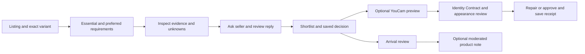
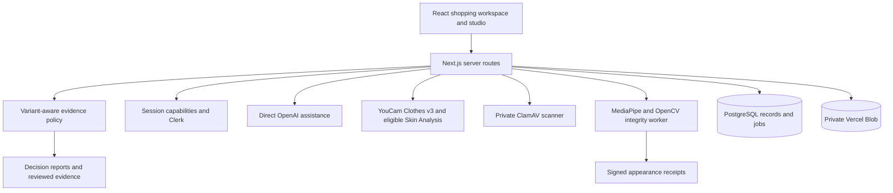

# AsShown — Love the Look. Know the Details.

**Next.js · React · TypeScript · YouCam Clothes v3 · OpenAI · PostgreSQL · Clerk · Vercel**

[Product preview](https://asshown-qs6yn2ou9-ankitlade12-3052s-projects.vercel.app) · [CI](https://github.com/ankitlade12/keepme/actions/workflows/ci.yml) · [Architecture](docs/architecture.md) · [Privacy](docs/privacy.md) · [MIT license](LICENSE)

> **Choose for your everyday needs. Preview the look. Keep what makes you, you.**

AsShown connects clothing discovery with the questions a product photo cannot answer. Shoppers confirm a garment’s exact variant, describe their practical requirements, inspect supporting evidence, and decide what still needs a seller’s answer. An optional YouCam preview explores the look while a separate Identity Contract records which personal features should stay unchanged.

The journey continues after delivery: compare the item with its listing, preserve private evidence, and contribute moderated product notes that can help the next shopper.

**Built for:** the YouCam API Skin AI & eCommerce Hackathon

**Proposed first users:** online clothing shoppers with practical care, fastening, sleeve, or pocket requirements

**Demo mode:** fictional listings and a synthetic shopper; clearly disclosed controlled repair, with separately consented live AI features

## Quick Highlights

- **Requirements first** — essential and preferred needs stay attached to each decision.
- **Evidence you can inspect** — variant-matched quotes distinguish supported statements, conflicts, and unknowns.
- **Useful seller questions** — resolve missing details without turning an image into proof.
- **Shortlists and history** — compare three items, reuse profiles, and export versioned decisions.
- **YouCam preview studio** — consent-based Clothes v3 generation with protected appearance regions.
- **Review and repair** — retain the original output, restore an eligible source zone, and inspect the new assessment.
- **Human-reviewed AI assistance** — requirement suggestions, Spanish translation, OCR, and coarse garment observations.
- **Arrival and community workflows** — compare delivered items and share moderated, correctable product notes.
- **Private by design** — separate processing consent, owner-authorized evidence, retention controls, and deletion.

## Live Deployment

| Surface        | Location                                                                                  | Access                                                                     |
| -------------- | ----------------------------------------------------------------------------------------- | -------------------------------------------------------------------------- |
| Product        | [Current Vercel preview](https://asshown-qs6yn2ou9-ankitlade12-3052s-projects.vercel.app) | Deployment protection; request a current share link from the project owner |
| Demo assets    | [Demo kit](public/demo-kit/README.md) · [Download ZIP](public/demo-kit.zip)               | Fictional listings, product images, synthetic shopper, and rehearsal guide |
| Runtime status | [/api/health](https://asshown-qs6yn2ou9-ankitlade12-3052s-projects.vercel.app/api/health) | Same deployment protection as the application                              |
| Source         | [GitHub repository](https://github.com/ankitlade12/keepme)                                | This repository retains the original KeepMe name                           |
| Verification   | [Quality workflow](.github/workflows/ci.yml)                                              | Unit, build, guided-flow, and accessibility checks                         |

**Status checked November 2, 2026:** the preview is deployed. The YouCam account had **zero API units**, so fresh live generation remains unavailable until units are replenished. The application checks the balance before reserving a generation. The controlled repair demo and direct OpenAI garment review have completed the hosted workflow.

A configured integration or healthy web server does not establish available provider quota. Temporary preview links are not a permanent judging-access arrangement. The narrated product video is distributed separately; generated recordings are excluded from Git.

## The Problem

A convincing clothing image leaves everyday questions unanswered:

- Can I machine wash this exact colour and size?
- Are these working pockets or decorative details?
- Does the fastening suit my requirements?
- Did a virtual try-on change my glasses or face as well as my jacket?
- If the delivered item differs, which listing and evidence should I keep?

AsShown explores this gap between appearance and suitability. Its intended community benefit is clearer, reusable shopping evidence; reduced returns, time savings, and real-user outcomes have not yet been established.

## The Solution

| Question                                              | Source of the answer                                                      |
| ----------------------------------------------------- | ------------------------------------------------------------------------- |
| Does the item meet my requirements?                   | Explicit, variant-matched listing statements and reviewed source evidence |
| What remains uncertain?                               | Missing statements, conflicts, and an editable seller question            |
| Do I like the look?                                   | An optional YouCam-generated preview                                      |
| Did the edit preserve my selected appearance regions? | Separate appearance checks against the Identity Contract                  |
| What arrived, and what can others learn?              | Reviewed delivery evidence and moderated contributor reports              |

A generated image cannot establish washing instructions, fabric composition, pocket function, comfort, or fit. Seller statements remain seller-reported; community observations remain contributor reports.

## Architecture Overview

### The Shopping Journey



### System Architecture



### Tech Stack

| Layer                | Technology                                                        | Purpose                                                                        |
| -------------------- | ----------------------------------------------------------------- | ------------------------------------------------------------------------------ |
| Interface            | Next.js App Router, React, TypeScript                             | Responsive shopping, review, and community workflows                           |
| Product policy       | TypeScript, Zod                                                   | Bounded requirements, exact variants, provenance, and explicit decision states |
| Virtual try-on       | YouCam Clothes v3                                                 | Generate the clothing preview after consent                                    |
| Appearance checks    | Python, FastAPI, MediaPipe, OpenCV; eligible YouCam Skin Analysis | Compare protected regions and expose uncertainty                               |
| Language and vision  | AI SDK with direct OpenAI provider                                | Reviewed suggestions, translation, OCR, and garment observations               |
| Identity and storage | Clerk, PostgreSQL, private Vercel Blob                            | Account access, private evidence, moderation, and cleanup                      |
| Upload safety        | Sharp, private ClamAV service                                     | Image validation, processing copies, and malware scanning                      |
| Delivery             | Vercel Services, Docker, GitHub Actions                           | Web/API, private workers, builds, and maintenance                              |

See [architecture](docs/architecture.md) for the implementation boundaries.

## Product Features

### Practical Requirements and Source Evidence

Paste listing text, add up to three JPEG/PNG product photos, and confirm the exact variant. Choose up to five requirements covering care, sleeves, pockets, closures, material, price, or custom needs. Essential requirements cannot be outweighed by preferences.

Inspect quoted source spans, add seller replies, and exclude or restore sources with a reason. Variant changes reevaluate current findings while historical reports retain their original inputs. Retailer-link imports, including Amazon scraping, are intentionally removed; intake uses pasted details and uploaded photos.

### Shortlists, Profiles, and Saved Decisions

Compare up to three items, choose a next action, save requirement profiles, and export readable or JSON decision snapshots. Guests have a short restore window; configured account storage supports explicit workspace saves across devices. Product photos held in browser memory do not survive refresh.

### YouCam Preview and Identity Protection

Approve the allowed garment edit and protection choices before provider uploads. The studio supports face geometry, skin appearance, hair, background, glasses, and custom preserve zones. Live results are assessed separately from the shopping evidence.

Unknown submissions remain reserved to prevent duplicate paid tasks. Known jobs can resume status checks. Empty provider balances stop before reservation. Eligible repairs preserve both the original output and the repaired result. Approval produces a signed receipt; its signature attests to the recorded data, not the truth of a product claim.

### Accessible, Human-Reviewed Assistance

Describe needs naturally, use browser dictation, request structured requirement suggestions or Spanish translation, and hear summaries read aloud. Direct OpenAI OCR and visual assistance require separate consent. Suggestions remain editable and cannot satisfy product requirements automatically.

Garment review compares visible neckline, sleeves, and fastening details. Full-size image links support manual inspection; unreliable model-generated coordinate overlays are not shown. Exporting reviewed observations requires an explicit human acknowledgment, which resets when the inputs or notes change.

### Arrival Review and Private Evidence

Record ordered and delivered colour/size, compare delivery photos with the original listing, and prepare a reviewed seller-message package. Selected original images can be included in a self-contained HTML export printable to PDF.

Signed-in shoppers can save private originals up to 10 MB, renew their 30-day retention, or delete them. Uploads pass quarantine and scanning before owner-authorized evidence access. Processing copies remain distinct from originals.

### Community Notes, Moderation, and Support

Contribute item-specific text and optional product-only photos with publication consent. Photo redaction and screening support an explicit moderator review. Reports move through pending, published, disputed, corrected, withdrawn, and removed states; disputed or withdrawn sources stop supporting current findings.

Accountable moderators review contributions, resolve support tickets, and can pause new paid processing with an audited reason. Reputation is not treated as a truth score. Community publication requires configured moderators and an enabled launch gate.

## Judge Quick Start

Use a current preview share link or run locally. The [demo kit](public/demo-kit/README.md) contains all fictional listing text and images.

1. **Check an item:** choose **Explore example**, or paste the rust-jacket listing and upload its photo.
2. **Set requirements:** keep machine washing and functional pockets essential; review sleeve preferences.
3. **Follow the evidence:** inspect the quoted washing instruction and the unknown pocket function. Add the kit’s simulated seller reply and observe the updated findings.
4. **Keep the decision:** shortlist the item and inspect profiles, history, or exports.
5. **Open the studio:** select **Identity drift demo**, protect the glasses, and approve the explicitly controlled scenario.
6. **Review and repair:** inspect the missing-glasses finding, then choose **Restore source zone & reverify**.
7. **Review garment details:** optionally consent to OpenAI assistance, inspect both images, add corrections, and acknowledge review before export.
8. **Finish:** approve the result, download the signed receipt, and choose **Delete images now**. Explore **Arrival check**, **Product notes**, and **Privacy & data** separately.

The controlled scenario deliberately demonstrates an appearance change and repair. It uses synthetic fixtures and makes no live YouCam generation request. Live mode requires available API units and the configured image services; use the actual returned result rather than assume a pass.

## Local Installation

Requirements: Node.js 22 and npm. The optional Python services use their supplied Dockerfiles.

```sh
git clone https://github.com/ankitlade12/keepme.git
cd keepme
git checkout feat/asshown-community-mvp
npm ci
cp .env.example .env.local
npm run dev -- --hostname localhost --port 3001
```

Open http://localhost:3001. Product-text checks and the controlled studio demonstration do not require provider credentials. Use `localhost` with Clerk enabled. The development-only file/in-memory adapters are not deployment storage.

## Configuration

Configure only the capabilities you intend to use. Keep credential values in local ignored environment files or host secrets.

| Variable                                                             | Purpose                                                          |
| -------------------------------------------------------------------- | ---------------------------------------------------------------- |
| `YOUCAM_API_KEY`                                                     | Server-side YouCam access; available API units are also required |
| `YOUCAM_API_BASE_URL`                                                | Defaults to the configured YouCam API host                       |
| `OPENAI_API_KEY`                                                     | Direct OpenAI access; no Vercel AI Gateway is used               |
| `ASSHOWN_AI_MODEL` / `ASSHOWN_VISION_MODEL`                          | Explicit model selection, such as `gpt-4.1-mini`                 |
| `DATABASE_URL`                                                       | PostgreSQL metadata, durable requests, and account records       |
| `BLOB_READ_WRITE_TOKEN`                                              | Private artifact and evidence storage                            |
| Clerk publishable/server keys                                        | Sign-in and account ownership                                    |
| `RECEIPT_SIGNING_SECRET` / `CRON_SECRET`                             | Receipt signatures and authenticated maintenance                 |
| `MALWARE_SCAN_URL` / `MALWARE_SCAN_TOKEN`                            | Authenticated private upload scanner                             |
| `INTEGRITY_WORKER_URL` or `INTEGRITY_URL` / `INTEGRITY_WORKER_TOKEN` | Private appearance-analysis worker                               |
| `SESSION_TTL_MINUTES`                                                | Temporary studio session lifetime; default 30 minutes            |
| `MAX_PROVIDER_TASKS_PER_SESSION`                                     | At most two paid tasks per session                               |
| `MAX_PROVIDER_TASKS_PER_HOUR` / `MAX_PROVIDER_TASKS_PER_DAY`         | Provider request budgets                                         |
| `MAX_ACCOUNT_GENERATIONS_PER_DAY`                                    | Additional daily generation limit                                |
| `ASSHOWN_COMMUNITY_ENABLED`                                          | Community publication gate                                       |
| `ASSHOWN_MODERATOR_IDS` / `ASSHOWN_MODERATOR_EMAILS`                 | Authorized moderators; emails must be verified                   |
| `ASSHOWN_PAID_FEATURES_ENABLED`                                      | Stops new paid processing when false                             |
| `RETAILER_EMAIL_ALLOWLIST`                                           | Access to the inherited retailer dashboard                       |

See [.env.example](.env.example) and [operations](docs/operations.md) for deployment configuration.

## Verification

```sh
npm test
npx tsc --noEmit
npm run lint
npm run build

# Install Chromium once; run with the dev server on port 3001.
npx playwright install chromium
node scripts/asshown-full-browser-qa.mjs
node scripts/asshown-demo-kit-smoke.mjs
KEEPME_URL=http://localhost:3001 npm run smoke:guided
```

Verified November 2, 2026: **87 application tests passed**, TypeScript passed, and the preview production build succeeded. Seven shopping-workspace scenarios and the hosted listing-to-repair-to-receipt journey passed. The latter included a real OpenAI review, human-confirmed export, mobile layout, and deleted-image access checks. Lint has warnings but no errors.

A fresh live YouCam attempt was rejected while the account had zero units. The subsequent empty-balance check returned HTTP 402 with **zero reserved provider tasks**. Earlier live successes do not establish present availability or evaluated accuracy.

Opt-in provider checks spend requests and use synthetic assets:

```sh
# Real YouCam generation; requires configured services and provider quota.
KEEPME_URL=https://your-preview.example node --env-file=.env.local scripts/live-flow-smoke.mjs

# Complete browser journey; LIVE_REVIEW=1 enables a real OpenAI review.
ASSHOWN_URL=http://localhost:3001 LIVE_REVIEW=1 node scripts/studio-review-e2e.mjs
```

Generated reports, recordings, local credentials, and account data remain ignored. Automated browser checks are not human accessibility certification or a held-out model evaluation.

## Repository Structure

```text
keepme/
├── app/                         # Product pages, styles, and server routes
├── components/                  # Shopping workspace, studio, and review UI
├── lib/asshown/                  # Requirements, evidence, accounts, and community
├── lib/                         # Sessions, YouCam, integrity, receipts, and storage
├── services/
│   ├── integrity-worker/        # FastAPI, MediaPipe, and OpenCV
│   └── malware-scanner/         # Private ClamAV upload boundary
├── db/migrations/               # Durable session and job schema
├── public/demo/                 # Disclosed synthetic studio assets
├── public/demo-kit/             # Product-demo inputs and walkthrough
├── calibration/                 # Evaluation protocol and threshold tooling
├── scripts/                     # Smoke, browser, and operational checks
├── docs/                        # Architecture, privacy, and operations
├── .github/workflows/           # Quality and maintenance automation
├── Dockerfile
├── vercel.json
└── .env.example
```

## Deployment

[vercel.json](vercel.json) defines the Next.js web app, private integrity worker, and private scanner. The root [Dockerfile](Dockerfile) provides a standalone web image for other hosting environments; it does not provision those dependencies.

1. Provision an isolated PostgreSQL database, private Blob store, and appropriate Clerk environment.
2. Apply session migrations with `npm run db:migrate`; provision the AsShown records table using the initialization described in [operations](docs/operations.md).
3. Configure server secrets and private service bindings. Keep `KEEPME_ALLOW_EPHEMERAL=false` and `KEEPME_AUTO_MIGRATE=false` for deployed operation.
4. Deploy a preview, verify the controlled journey and cleanup, then explicitly verify live provider availability.
5. Configure monitored maintenance and a stable judge-access arrangement before submission or public rollout.

Provider calls, hosting, and storage can incur costs. The current preview is not an approved production launch.

## API Surface

| Route                                               | Purpose                                                          |
| --------------------------------------------------- | ---------------------------------------------------------------- |
| `/api/asshown/workspace`                            | Guest/account state and explicit saved workspaces                |
| `/api/asshown/assist`, `/extract`, `/vision`        | Consented language, OCR, and visual suggestions                  |
| `/api/asshown/assets` and upload routes             | Owner-authorized private evidence                                |
| `/api/asshown/community` and community-media routes | Contributions, moderation, and publication lifecycle             |
| `/api/asshown/support`, `/operations`               | Support and audited processing controls                          |
| `/api/v1/sessions`                                  | Private preview session lifecycle                                |
| `/api/v1/sessions/[id]/[action]`                    | Contract, generation, status, verification, repair, and approval |
| `/api/v1/receipts/verify`                           | Signed receipt verification                                      |
| `/api/internal/maintenance`                         | Authenticated expiry and deletion work                           |
| `/api/health`                                       | Runtime dependency status; not a provider-quota guarantee        |

The retired retailer import endpoint returns HTTP 410 and makes no outbound product requests.

## Privacy and Decision Boundaries

Guest restore lasts 30 minutes and excludes uploaded photos after refresh. Account evidence has separate retention and renewal. Application deletion and downstream provider retention are separate obligations. Publication, storage, and model processing have separate consent gates.

Neither an appearance score nor a signed receipt establishes fit, comfort, fabric properties, pocket function, medical suitability, or seller honesty. Unknown and conflicting evidence stays visible. See [privacy and provenance](docs/privacy.md).

## Project Origins and Next Steps

AsShown builds on the MIT-licensed KeepMe baseline, commit [`2c4053d`](https://github.com/ankitlade12/keepme/tree/2c4053db1c5b3144be29340f57a5419824db4b96). The original project is preserved in Git history.

The hackathon expansion adds variant-aware shopping evidence, requirements, seller replies, shortlists, account workspaces, profiles, community moderation, arrival review, language assistance, support, and the responsive AsShown interface. It also strengthens consent, duplicate-task prevention, repair lineage, and deletion behavior.

Before a public launch, complete owned/licensed case evaluation, independent human review, user interviews, manual accessibility work, moderator staffing, provider-retention review, and backup/cleanup incident drills. No evaluated accuracy, reduced-return benefit, or commercial outcome is claimed. Subscription billing is not implemented.

## License

[MIT](LICENSE) © 2026 Ankit Lade.

_Check the evidence. Preview the look. Keep your choice._
