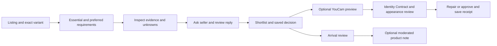
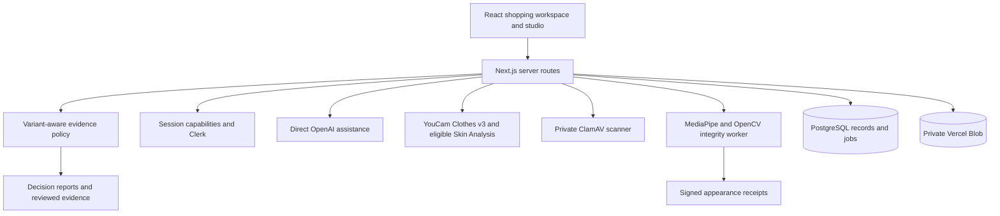

# AsShown + KeepMe — Shop with Evidence. Preview with Confidence.

**Next.js · React · TypeScript · YouCam Clothes v3 · OpenAI · PostgreSQL · Clerk · Vercel**

[Product preview](https://asshown-qs6yn2ou9-ankitlade12-3052s-projects.vercel.app) · [Architecture](docs/architecture.md) · [Privacy](docs/privacy.md) · [MIT license](LICENSE)

> **Choose for your everyday needs. Preview the look. Keep what makes you, you.**

AsShown connects clothing discovery with the questions a product photo cannot answer. Shoppers confirm a garment’s exact variant, describe their practical requirements, inspect supporting evidence, and decide what still needs a seller’s answer. An optional YouCam preview explores the look while a separate Identity Contract records which personal features should stay unchanged.

The journey continues after delivery: compare the item with its listing, preserve private evidence, and contribute moderated product notes that can help the next shopper.

**Built for:** the YouCam API Skin AI & eCommerce Hackathon

**Proposed first users:** online clothing shoppers with practical care, fastening, sleeve, or pocket requirements

**Demo mode:** fictional listings and a synthetic shopper; clearly disclosed controlled repair, with separately consented live AI features

## AsShown and KeepMe

This repository contains one integrated application with two complementary parts. **AsShown** is the shopping experience; **KeepMe** is the appearance-preservation foundation used in its YouCam studio. Both are included on `main`.

| | AsShown — Love the look. Know the details. | KeepMe — Change the clothes, not the person. |
| --- | --- | --- |
| Focus | Does this item meet my everyday requirements? | Did the preview change a protected appearance detail? |
| Main experience | Listing, exact variant, requirements, source evidence, and shortlist | Photos, Identity Contract, preserve map, generation, and appearance review |
| Follow-through | Seller replies, saved decisions, arrival checks, and moderated community notes | Eligible source-zone repair, reverification, signed receipt, and session deletion |
| Where to start | `/check` | `/studio` |

### KeepMe: the preview foundation

Before a try-on, the shopper approves the garment edit and selects the appearance regions to protect. KeepMe records that Identity Contract, supports custom preserve zones, and surfaces appearance findings for review. Eligible source-zone repairs retain the original result alongside the repaired version. The shopper can download a signed review receipt and delete the session images.

The inherited `/dashboard` provides authorized retailer access to tenant-scoped operational aggregates. The session API and receipt verification remain available under `/api/v1`.

KeepMe checks appearance changes; it is not identity verification or a guarantee of fit. The controlled demo uses disclosed synthetic fixtures. Live analysis depends on configured services and provider quota, and its accuracy still requires broader evaluation.

### AsShown: the shopping and community expansion

AsShown adds the practical context around the preview: what the shopper needs, what the exact listing states, what remains unknown, and what arrives after purchase. Seller replies and community reports retain their source identity instead of becoming unqualified facts. A preview cannot establish care instructions or pocket function.

Together, the two parts connect **product evidence → shopping decision → appearance review → arrival observations** without confusing visual appeal with functional suitability.

## Quick Highlights

- **Requirements first** — essential and preferred needs stay attached to each decision.
- **Evidence you can inspect** — variant-matched quotes distinguish supported statements, conflicts, and unknowns.
- **Useful seller questions** — resolve missing details without turning an image into proof.
- **Shortlists and history** — compare three items, reuse profiles, and export versioned decisions.
- **YouCam preview studio** — consent-based Clothes v3 generation with protected appearance regions.
- **Review and repair** — retain the original output, restore an eligible source zone, and inspect the new assessment.
- **Human-reviewed AI assistance** — requirement suggestions, Spanish translation, OCR, and coarse garment observations.
- **Arrival and community workflows** — compare delivered items and share moderated, correctable product notes.
- **Private by design** — separate processing consent, owner-authorized evidence, retention controls, and deletion.

## The Problem

A convincing clothing image leaves everyday questions unanswered:

- Can I machine wash this exact colour and size?
- Are these working pockets or decorative details?
- Does the fastening suit my requirements?
- Did a virtual try-on change my glasses or face as well as my jacket?
- If the delivered item differs, which listing and evidence should I keep?

AsShown explores this gap between appearance and suitability. Its intended community benefit is clearer, reusable shopping evidence; reduced returns, time savings, and real-user outcomes have not yet been established.

## The Solution

| Question                                              | Source of the answer                                                      |
| ----------------------------------------------------- | ------------------------------------------------------------------------- |
| Does the item meet my requirements?                   | Explicit, variant-matched listing statements and reviewed source evidence |
| What remains uncertain?                               | Missing statements, conflicts, and an editable seller question            |
| Do I like the look?                                   | An optional YouCam-generated preview                                      |
| Did the edit preserve my selected appearance regions? | Separate appearance checks against the Identity Contract                  |
| What arrived, and what can others learn?              | Reviewed delivery evidence and moderated contributor reports              |

A generated image cannot establish washing instructions, fabric composition, pocket function, comfort, or fit. Seller statements remain seller-reported; community observations remain contributor reports.

## Architecture Overview

### The Shopping Journey



### System Architecture



### Tech Stack

| Layer                | Technology                                                        | Purpose                                                                        |
| -------------------- | ----------------------------------------------------------------- | ------------------------------------------------------------------------------ |
| Interface            | Next.js App Router, React, TypeScript                             | Responsive shopping, review, and community workflows                           |
| Product policy       | TypeScript, Zod                                                   | Bounded requirements, exact variants, provenance, and explicit decision states |
| Virtual try-on       | YouCam Clothes v3                                                 | Generate the clothing preview after consent                                    |
| Appearance checks    | Python, FastAPI, MediaPipe, OpenCV; eligible YouCam Skin Analysis | Compare protected regions and expose uncertainty                               |
| Language and vision  | AI SDK with direct OpenAI provider                                | Reviewed suggestions, translation, OCR, and garment observations               |
| Identity and storage | Clerk, PostgreSQL, private Vercel Blob                            | Account access, private evidence, moderation, and cleanup                      |
| Upload safety        | Sharp, private ClamAV service                                     | Image validation, processing copies, and malware scanning                      |
| Delivery             | Vercel Services, Docker, GitHub Actions                           | Web/API, private workers, builds, and maintenance                              |

See [architecture](docs/architecture.md) for the implementation boundaries.

## Product Features

### Practical Requirements and Source Evidence

Paste listing text, add up to three JPEG/PNG product photos, and confirm the exact variant. Choose up to five requirements covering care, sleeves, pockets, closures, material, price, or custom needs. Essential requirements cannot be outweighed by preferences.

Inspect quoted source spans, add seller replies, and exclude or restore sources with a reason. Variant changes reevaluate current findings while historical reports retain their original inputs. Retailer-link imports, including Amazon scraping, are intentionally removed; intake uses pasted details and uploaded photos.

### Shortlists, Profiles, and Saved Decisions

Compare up to three items, choose a next action, save requirement profiles, and export readable or JSON decision snapshots. Guests have a short restore window; configured account storage supports explicit workspace saves across devices. Product photos held in browser memory do not survive refresh.

### YouCam Preview and Identity Protection

Approve the allowed garment edit and protection choices before provider uploads. The studio supports face geometry, skin appearance, hair, background, glasses, and custom preserve zones. Live results are assessed separately from the shopping evidence.

Unknown submissions remain reserved to prevent duplicate paid tasks. Known jobs can resume status checks. Empty provider balances stop before reservation. Eligible repairs preserve both the original output and the repaired result. Approval produces a signed receipt; its signature attests to the recorded data, not the truth of a product claim.

### Accessible, Human-Reviewed Assistance

Describe needs naturally, use browser dictation, request structured requirement suggestions or Spanish translation, and hear summaries read aloud. Direct OpenAI OCR and visual assistance require separate consent. Suggestions remain editable and cannot satisfy product requirements automatically.

Garment review compares visible neckline, sleeves, and fastening details. Full-size image links support manual inspection; unreliable model-generated coordinate overlays are not shown. Exporting reviewed observations requires an explicit human acknowledgment, which resets when the inputs or notes change.

### Arrival Review and Private Evidence

Record ordered and delivered colour/size, compare delivery photos with the original listing, and prepare a reviewed seller-message package. Selected original images can be included in a self-contained HTML export printable to PDF.

Signed-in shoppers can save private originals up to 10 MB, renew their 30-day retention, or delete them. Uploads pass quarantine and scanning before owner-authorized evidence access. Processing copies remain distinct from originals.

### Community Notes, Moderation, and Support

Contribute item-specific text and optional product-only photos with publication consent. Photo redaction and screening support an explicit moderator review. Reports move through pending, published, disputed, corrected, withdrawn, and removed states; disputed or withdrawn sources stop supporting current findings.

Accountable moderators review contributions, resolve support tickets, and can pause new paid processing with an audited reason. Reputation is not treated as a truth score. Community publication requires configured moderators and an enabled launch gate.

## Try the Demo

The [demo kit](public/demo-kit/README.md) includes fictional listings, product photos, and a synthetic shopper. [Download all demo assets](public/demo-kit.zip).

1. **Explore an item:** open **Check an item → Explore example** and review its requirements.
2. **Inspect the evidence:** see which details are supported, then add the sample seller reply to resolve the pocket question.
3. **Save your choice:** add the item to your shortlist.
4. **Preview and review:** open the studio and choose **Identity drift demo** to explore the glasses-protection and repair workflow.
5. **Finish your review:** approve the result, save its receipt, and delete the session images.
6. **Continue after delivery:** explore **Arrival check**, **Product notes**, and **Privacy & data**.

The identity-drift demo is a clearly labelled controlled example using synthetic images. Live YouCam generation requires available provider credits and configured services.

## Configuration

Configure only the capabilities you intend to use. Keep credential values in local ignored environment files or host secrets.

| Variable                                                             | Purpose                                                          |
| -------------------------------------------------------------------- | ---------------------------------------------------------------- |
| `YOUCAM_API_KEY`                                                     | Server-side YouCam access; available API units are also required |
| `YOUCAM_API_BASE_URL`                                                | Defaults to the configured YouCam API host                       |
| `OPENAI_API_KEY`                                                     | Direct OpenAI access; no Vercel AI Gateway is used               |
| `ASSHOWN_AI_MODEL` / `ASSHOWN_VISION_MODEL`                          | Explicit model selection, such as `gpt-4.1-mini`                 |
| `DATABASE_URL`                                                       | PostgreSQL metadata, durable requests, and account records       |
| `BLOB_READ_WRITE_TOKEN`                                              | Private artifact and evidence storage                            |
| Clerk publishable/server keys                                        | Sign-in and account ownership                                    |
| `RECEIPT_SIGNING_SECRET` / `CRON_SECRET`                             | Receipt signatures and authenticated maintenance                 |
| `MALWARE_SCAN_URL` / `MALWARE_SCAN_TOKEN`                            | Authenticated private upload scanner                             |
| `INTEGRITY_WORKER_URL` or `INTEGRITY_URL` / `INTEGRITY_WORKER_TOKEN` | Private appearance-analysis worker                               |
| `SESSION_TTL_MINUTES`                                                | Temporary studio session lifetime; default 30 minutes            |
| `MAX_PROVIDER_TASKS_PER_SESSION`                                     | At most two paid tasks per session                               |
| `MAX_PROVIDER_TASKS_PER_HOUR` / `MAX_PROVIDER_TASKS_PER_DAY`         | Provider request budgets                                         |
| `MAX_ACCOUNT_GENERATIONS_PER_DAY`                                    | Additional daily generation limit                                |
| `ASSHOWN_COMMUNITY_ENABLED`                                          | Community publication gate                                       |
| `ASSHOWN_MODERATOR_IDS` / `ASSHOWN_MODERATOR_EMAILS`                 | Authorized moderators; emails must be verified                   |
| `ASSHOWN_PAID_FEATURES_ENABLED`                                      | Stops new paid processing when false                             |
| `RETAILER_EMAIL_ALLOWLIST`                                           | Access to the inherited retailer dashboard                       |

See [.env.example](.env.example) and [operations](docs/operations.md) for deployment configuration.

## Repository Structure

```text
keepme/
├── app/                         # Product pages, styles, and server routes
├── components/                  # Shopping workspace, studio, and review UI
├── lib/asshown/                  # Requirements, evidence, accounts, and community
├── lib/                         # Sessions, YouCam, integrity, receipts, and storage
├── services/
│   ├── integrity-worker/        # FastAPI, MediaPipe, and OpenCV
│   └── malware-scanner/         # Private ClamAV upload boundary
├── db/migrations/               # Durable session and job schema
├── public/demo/                 # Disclosed synthetic studio assets
├── public/demo-kit/             # Product-demo inputs and walkthrough
├── calibration/                 # Evaluation protocol and threshold tooling
├── scripts/                     # Smoke, browser, and operational checks
├── docs/                        # Architecture, privacy, and operations
├── .github/workflows/           # Quality and maintenance automation
├── Dockerfile
├── vercel.json
└── .env.example
```

## API Surface

| Route                                               | Purpose                                                          |
| --------------------------------------------------- | ---------------------------------------------------------------- |
| `/api/asshown/workspace`                            | Guest/account state and explicit saved workspaces                |
| `/api/asshown/assist`, `/extract`, `/vision`        | Consented language, OCR, and visual suggestions                  |
| `/api/asshown/assets` and upload routes             | Owner-authorized private evidence                                |
| `/api/asshown/community` and community-media routes | Contributions, moderation, and publication lifecycle             |
| `/api/asshown/support`, `/operations`               | Support and audited processing controls                          |
| `/api/v1/sessions`                                  | Private preview session lifecycle                                |
| `/api/v1/sessions/[id]/[action]`                    | Contract, generation, status, verification, repair, and approval |
| `/api/v1/receipts/verify`                           | Signed receipt verification                                      |
| `/api/internal/maintenance`                         | Authenticated expiry and deletion work                           |
| `/api/health`                                       | Runtime dependency status; not a provider-quota guarantee        |

The retired retailer import endpoint returns HTTP 410 and makes no outbound product requests.

## Privacy and Decision Boundaries

Guest restore lasts 30 minutes and excludes uploaded photos after refresh. Account evidence has separate retention and renewal. Application deletion and downstream provider retention are separate obligations. Publication, storage, and model processing have separate consent gates.

Neither an appearance score nor a signed receipt establishes fit, comfort, fabric properties, pocket function, medical suitability, or seller honesty. Unknown and conflicting evidence stays visible. See [privacy and provenance](docs/privacy.md).

## License

[MIT](LICENSE) © 2026 Ankit Lade.

_Check the evidence. Preview the look. Keep your choice._
