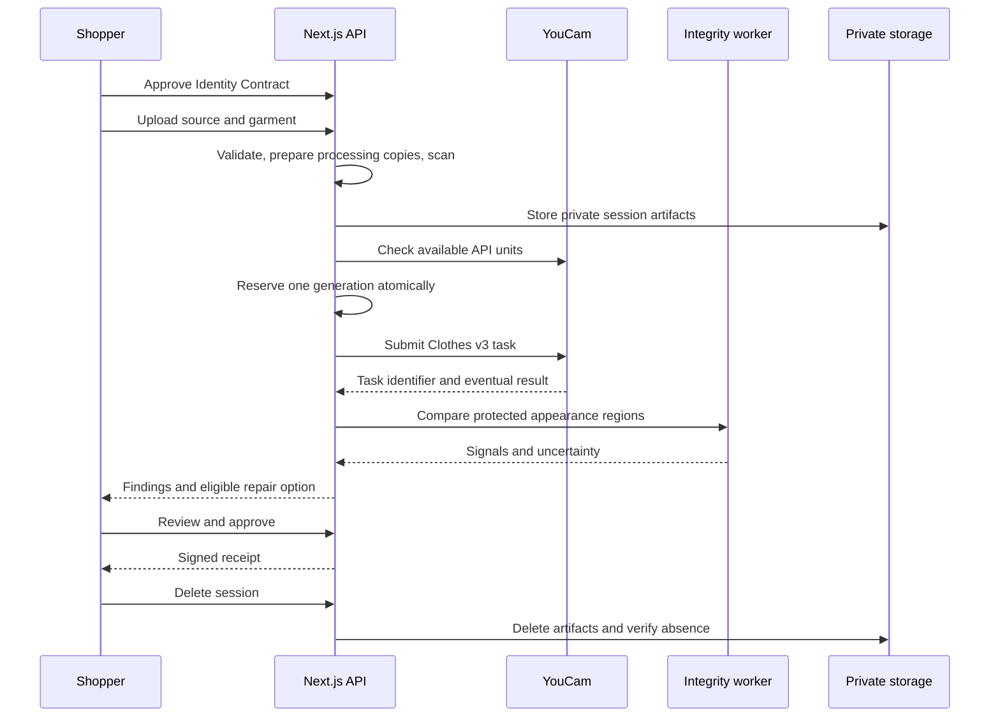

# Architecture

AsShown has two connected workflows: source-based shopping decisions and a consent-based appearance preview. Start with the [README](../README.md) for setup and the product story.

## Shopping evidence

`components/ShoppingWorkspace.tsx` coordinates listing intake, exact variants, requirements, seller replies, shortlists, saved checks, arrival review, and community notes. `lib/asshown/policy.ts` applies the deterministic evidence policy; language-model output does not control it.

Sources retain their text, variant, provenance, and inclusion history. Findings distinguish supported statements, conflicts, and unknowns. Essential requirements cannot be offset by preferred ones. Saved reports preserve historical inputs; current findings can change when requirements, variants, sources, or community publication status change.

`lib/asshown/records.ts` stores owner/category-scoped records and revisions in PostgreSQL. It creates the records table and index on initialization. The local JSON adapter is development-only and refuses production use without a database.

## Preview lifecycle

Relevant modules: `lib/youcam.ts`, `lib/session-store.ts`, `lib/live-integrity.ts`, `lib/integrity.ts`, `lib/receipt-signing.ts`, and `app/api/v1/sessions/`.

A pending reservation is retained if the submission outcome is unknown. Reloads and concurrent clicks do not create another paid task. Known task IDs support polling. HTTP failure status and safe diagnostics are recorded without exposing provider response bodies. The balance guard rejects an empty account before reservation; a positive balance is not a guarantee that every subsequent provider operation can complete.

The guided mode uses explicitly disclosed synthetic artifacts and deterministic results. Its glasses-removal/repair scenario exercises the contract and receipt workflow without claiming a fresh live provider result. Live mode uses Clothes v3 and the private worker, with eligible Skin Analysis signals. Inconclusive results remain distinct from passing results.

## Review, repair, and receipts

Protected-region failures and alignment/quality limits can override aggregate scores. Eligible repair restores a source region and retains the original output separately. A receipt binds decision metadata and digests using HS256; it is not proof of garment suitability or independently validated model accuracy. See the [calibration protocol](../calibration/README.md).

OpenAI garment observations are a separate, consented request. `components/VisualReviewPanel.tsx` resets observations and consent when image inputs change and requires human confirmation before a reviewed export. Directly uploaded data URLs are converted to files without a network fetch. Raw model coordinates are not presented as reliable annotations.

## External services

| Service                     | Boundary                                                                                            |
| --------------------------- | --------------------------------------------------------------------------------------------------- |
| YouCam Clothes v3           | Server-side authenticated generation after consent and request-budget checks                        |
| YouCam Skin Analysis        | Optional eligible appearance signals; no medical conclusion                                         |
| OpenAI                      | Explicit model selection through `@ai-sdk/openai`; separate language/OCR/vision consent; no Gateway |
| Integrity worker            | Private FastAPI service using MediaPipe/OpenCV; token authenticated                                 |
| ClamAV scanner              | Private token-authenticated upload boundary; failure does not become a clean verdict                |
| Clerk                       | Account identity and moderator/retailer access checks                                               |
| PostgreSQL and private Blob | Durable metadata, ownership, jobs, and authorized image storage                                     |

`vercel.json` binds the two private services to the web service. Scanner requests for larger originals use a short-lived, GET-only private Blob reference with host, size, redirect, and content-hash checks. Processing copies never replace original evidence silently.

## Community and maintenance

Community publication is explicitly gated. Owners submit/correct/withdraw; moderators review, publish, remove, or resolve disputes. Photo publication requires separate consent and an image-review acknowledgment. Current shopping findings stop using unavailable, disputed, withdrawn, or variant-mismatched reports.

Private assets use quarantine, bounded upload intents, owner-authorized reads, expiry, renewal, and cleanup. Deletion revokes access before retryable physical cleanup. Maintenance processes expiry and cleanup jobs; deployment of a schedule is not proof it runs reliably.

See [privacy](privacy.md) for the data lifecycle and [operations](operations.md) for provisioning and release gates.
